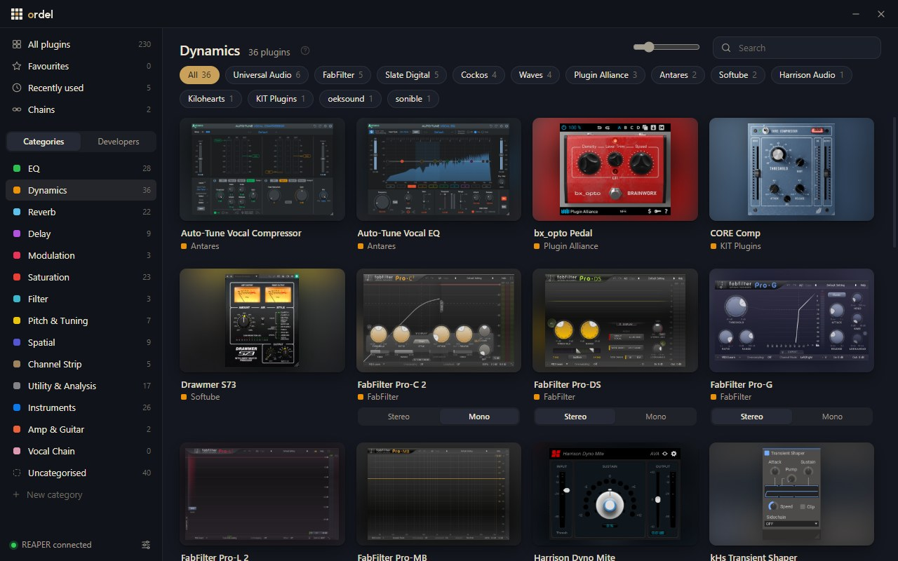
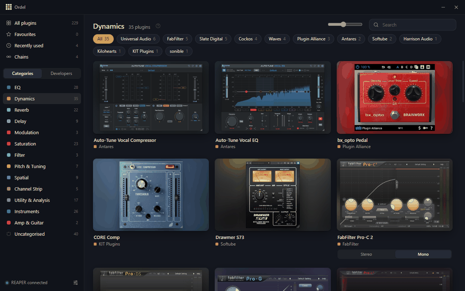

<picture>
  <source media="(prefers-color-scheme: dark)" srcset="brand/final/ordel-lockup-horizontal-reversed.svg">
  
</picture>

Ordel is a plugin browser for REAPER on Windows. It shows each installed plugin as a picture of its own interface instead of a line of text, and adds it to the selected track when you click it.

[Download Ordel for Windows](https://github.com/cjpheasey/ordel/releases/latest/download/Ordel-Setup.exe) (free, requires REAPER)

## How it works

Ordel reads the plugin list that REAPER builds when it scans your plugin folders, so it shows the same VST, VST3 and CLAP plugins that REAPER can load. The first time it runs, it opens each plugin once and takes a picture of its window. This takes a few minutes for a large collection and can run in the background. Plugins that crash or freeze while being opened are skipped, and REAPER keeps running.

Plugins are sorted into categories such as EQ, Dynamics and Reverb, based on the tags developers give REAPER. You can drag a plugin into a different category or make categories of your own. The sidebar can also list plugins by developer. When a plugin comes in several versions, such as stereo, mono and sidechain, they share one card with a switch to choose between them.

Ctrl+Shift+Space opens Ordel from any program, REAPER included. You can start typing straight away to search by name, developer or category. Clicking the + on a card, double-clicking it or pressing Enter puts the plugin on the selected REAPER track and opens its window. Plugins you star appear under Favourites, and the last ones you added are listed under Recently used.

Chains are groups of plugins. You can save the plugins on a REAPER track as a chain, settings included, and later add the whole chain to one or more tracks at once, or to a new return track for sends. Chains saved in REAPER itself show up too.

There are four colour themes, plus options for accent colour, picture size and layout density.

## Installing

Run Ordel-Setup.exe. The installer is not signed, so Windows may show a "Windows protected your PC" message. Click More info, then Run anyway. On first launch Ordel finds your plugins, connects to REAPER and offers to take the pictures.

Ordel needs Windows 10 or 11 and the 64-bit version of REAPER. Uninstalling it removes its script from REAPER and asks whether to keep your saved pictures and settings.

## Licence

Copyright © 2026 Charlie Pheasey. See [LICENSE](LICENSE).
